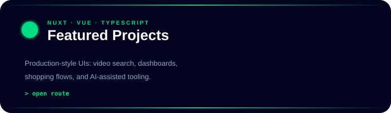
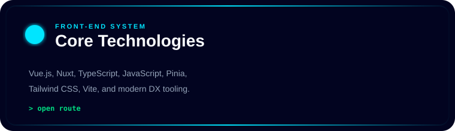
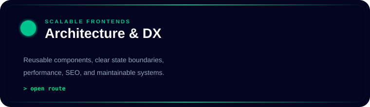
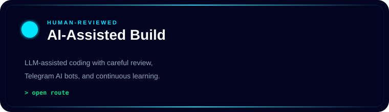
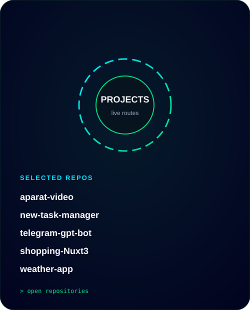
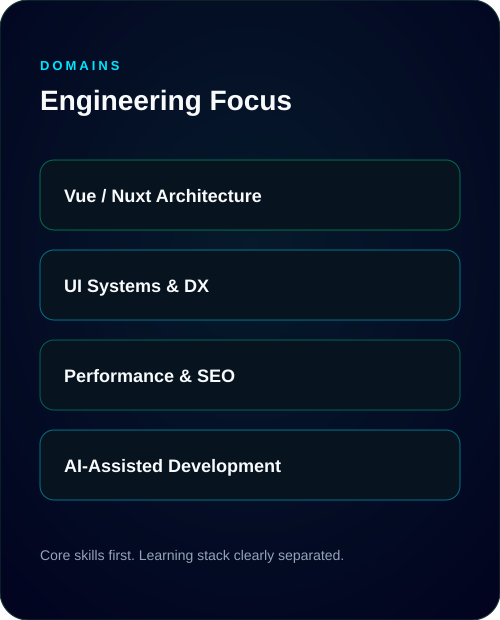
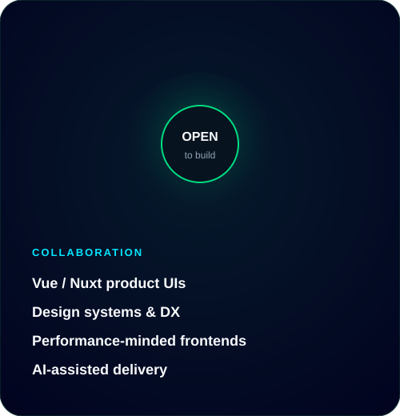

<p align="center">
  
</p>

<h3 align="center">
  <samp>
    &gt; Hey there, I am
    <b><a href="https://www.linkedin.com/in/ardalan-shahandeh">Ardalan Shahandeh</a></b>
  </samp>
</h3>

<p align="center">
  <samp>「 Front-End Engineer building scalable Vue.js and Nuxt applications 」</samp>
</p>

<p align="center">
  <a href="https://github.com/Ardalan-Shahandeh"></a>
  <a href="https://www.linkedin.com/in/ardalan-shahandeh"></a>
  <a href="mailto:shahandeh.dev@gmail.com"></a>
  <a href="https://komarev.com/ghpvc/?username=Ardalan-Shahandeh&label=Profile%20views&color=00DC82&style=flat-square"></a>
</p>

<p align="center">
  
</p>

<p align="center">
  <a href="#-selected-work"><b>Projects</b></a>
  &nbsp;|&nbsp;
  <a href="#-technologies"><b>Technologies</b></a>
  &nbsp;|&nbsp;
  <a href="#-collaboration--contact"><b>Contact</b></a>
</p>

<p align="center">
  
</p>

<p align="center">
  
</p>

<p align="center">
  <a href="#-selected-work">
    
  </a>
</p>

<p align="center">
  <a href="#-technologies">
    
  </a>
  <a href="#ardalan-core">
    
  </a>
  <a href="https://github.com/Ardalan-Shahandeh/telegram-gpt-bot">
    
  </a>
</p>

<p align="center">
  
</p>

<p align="center" id="ardalan-core">
  
</p>

<p align="center">
  
</p>

## About

I’m **Ardalan Shahandeh**, a Front-End Engineer with **5+ years** of experience shipping production web applications.

My day-to-day toolkit is **Vue.js, Nuxt, TypeScript, JavaScript, Pinia, and Tailwind CSS**. I care about clear architecture, reusable UI systems, performance, SEO, and code that stays maintainable — including PWAs, SDKs, dashboards, and component libraries.

I’m currently expanding into **React, Next.js, Node.js, Docker, and AI-assisted development**, with human review at every important boundary.

```ts
const ardalan = {
  role: "Front-End Engineer",
  core: ["Vue", "Nuxt", "TypeScript", "JavaScript", "Pinia", "Tailwind CSS"],
  focus: ["architecture", "performance", "design systems", "developer experience"],
  learning: ["React", "Next.js", "Node.js", "Docker", "AI tooling"],
};
```

<p align="center">
  
</p>

# 🛠 Technologies, Projects, and Domains

<table border="0" cellspacing="10" cellpadding="0">
<tr>
<td width="420" valign="top" align="center">

### 🛠 Technologies

<br/>

<table align="center" cellspacing="0" cellpadding="6">
  <tr>
    <td align="center"></td>
    <td align="center"></td>
    <td align="center"></td>
    <td align="center"></td>
    <td align="center"></td>
  </tr>
  <tr>
    <td align="center"></td>
    <td align="center"></td>
    <td align="center"></td>
    <td align="center"></td>
    <td align="center"></td>
  </tr>
  <tr>
    <td align="center"></td>
    <td align="center"></td>
    <td align="center"></td>
    <td align="center"></td>
    <td align="center"></td>
  </tr>
  <tr>
    <td align="center"></td>
    <td align="center" colspan="4"></td>
  </tr>
</table>

<p><sub>Core: Vue · Nuxt · TypeScript · Pinia · Tailwind<br/>Exploring: React · Next.js · Node.js · Docker · AI tooling</sub></p>

</td>
<td width="260" valign="top" align="center">

### 🧪 Projects

<br/>

<a href="#-selected-work">
  
</a>

</td>
<td width="260" valign="top" align="center">

### 🧠 Domains

<br/>

<a href="#ardalan-core">
  
</a>

</td>
</tr>
</table>

<p align="center">
  
</p>

## 🚀 Selected Work

| Project | Stack | What it demonstrates |
| :--- | :--- | :--- |
| [aparat-video](https://github.com/Ardalan-Shahandeh/aparat-video) | Nuxt 3 · Vue · Tailwind | RTL video browse/search UI with pagination, detail pages, and Aparat API integration. |
| [new-task-manager](https://github.com/Ardalan-Shahandeh/new-task-manager) | Vue 3 · TypeScript · Pinia · Vuetify | Task dashboard with auth flow, CRUD, search, and a reusable admin-style UI. |
| [telegram-gpt-bot](https://github.com/Ardalan-Shahandeh/telegram-gpt-bot) | TypeScript · Node.js | Telegram AI assistant with OpenRouter integration and strict TypeScript. |
| [shopping-Nuxt3](https://github.com/Ardalan-Shahandeh/shopping-Nuxt3) | Nuxt 3 · Tailwind | Nuxt shopping UI exploring composition, routing, and utility-first styling. |
| [weather-app](https://github.com/Ardalan-Shahandeh/weather-app) | Nuxt 3 · Tailwind | Compact weather client built with Vue 3 / Nuxt 3. |

<p align="center">
  
</p>

### 📊 Vital Statistics

<div align="center">
  
  <br/>
  <a href="https://github.com/Ardalan-Shahandeh">
    
  </a>
  <a href="https://github.com/Ardalan-Shahandeh">
    
  </a>
  <br/>
  
</div>

<p align="center">
  
</p>

## 🐍 Contribution Snake

Generated by GitHub Actions from my real contribution graph and published to the `output` branch.

<div align="center">
  <picture>
    <source media="(prefers-color-scheme: dark)" srcset="https://raw.githubusercontent.com/ardalan-shahandeh/ardalan-shahandeh/output/github-contribution-grid-snake-dark.svg" />
    <source media="(prefers-color-scheme: light)" srcset="https://raw.githubusercontent.com/ardalan-shahandeh/ardalan-shahandeh/output/github-contribution-grid-snake.svg" />
    
  </picture>
</div>

<p align="center">
  
</p>

## 🤝 Collaboration & Contact

<table border="0">
<tr>
<td width="340" valign="top">

### Collaboration

I’m interested in collaborating on:

- Vue.js / Nuxt product frontends
- Reusable UI systems and design systems
- Performance-minded web applications
- AI-assisted frontend delivery with human review

</td>
<td width="280" valign="top" align="center">

<a href="mailto:shahandeh.dev@gmail.com">
  
</a>

</td>
<td width="300" valign="top" align="center">

### Contact

<a href="https://github.com/Ardalan-Shahandeh"></a>

<a href="https://www.linkedin.com/in/ardalan-shahandeh"></a>

<a href="mailto:shahandeh.dev@gmail.com"></a>

</td>
</tr>
</table>

<p align="center">
  
</p>

<p align="center">
  <samp>⚡ Building scalable frontend systems with Vue, Nuxt, and TypeScript</samp>
</p>

<p align="center">
  
</p>
